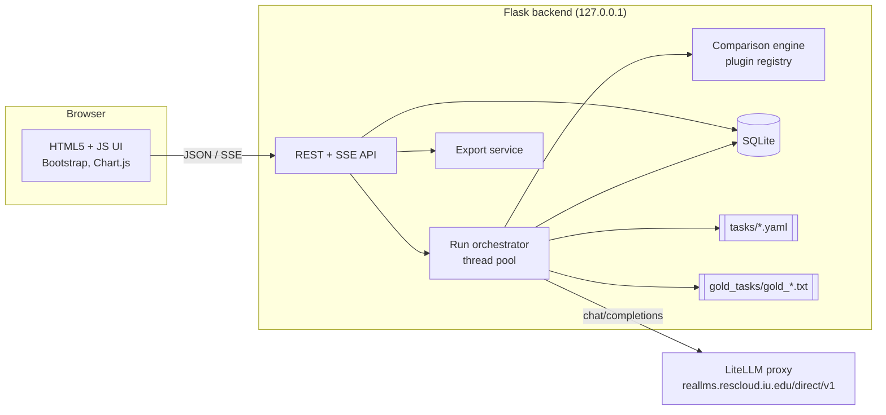

# aphasia-llm-eval

**Compare a zoo of large language models on aphasia clinical tasks, side by side, through a LiteLLM gateway.**

You choose which models and which tasks to run. The app sends each task to each model, compares every answer with a configured reference file, and shows that comparison next to input tokens, output tokens, estimated cost, and time. Results export to CSV, JSON, XLSX, and PDF.

v0.1 ships two tasks: **Correct Information Unit (CIU) scoring** and **parts-of-speech (POS) breakdown**. Tasks are defined in configuration files, so new benchmarks are added without changing application code in the common case.

> **Status:** v0.1 beta candidate. The application, synthetic demo workflow, and clinically reviewed Cat Rescue CIU reference are implemented. The Cat Rescue POS reference is provisional and must be independently reviewed or replaced before it is treated as an authoritative gold standard. Items marked **[Verify]** depend on the target LiteLLM proxy; run `python scripts/check_endpoint.py --model <model-id>` to inspect them.
>
> **Not a clinical tool.** This project evaluates language models for research. It must not be used to diagnose, treat, or make care decisions about any person. Do not send protected health information (PHI) or identifiable patient data to the app. See [Data and privacy](#15-data-and-privacy).
>
> **Local, single-user tool.** The app binds to `127.0.0.1` and has no login. Do not expose it to a network. See [Security](#16-security).

---

## Table of contents

1. [Goals and non-goals](#1-goals-and-non-goals)
2. [Core concepts](#2-core-concepts)
3. [Architecture](#3-architecture)
4. [Technology stack](#4-technology-stack)
5. [Repository structure](#5-repository-structure)
6. [Configuration](#6-configuration)
7. [LiteLLM integration](#7-litellm-integration)
8. [Tasks](#8-tasks)
9. [Gold files](#9-gold-files)
10. [Comparison with gold](#10-comparison-with-gold)
11. [Backend API](#11-backend-api)
12. [User interface](#12-user-interface)
13. [Export](#13-export)
14. [Data model](#14-data-model)
15. [Data and privacy](#15-data-and-privacy)
16. [Security](#16-security)
17. [Error handling and reliability](#17-error-handling-and-reliability)
18. [Testing and CI](#18-testing-and-ci)
19. [Quick start](#19-quick-start)
20. [Roadmap](#20-roadmap)
21. [Contributing, license, references](#21-contributing-license-references)
22. [Open questions and assumptions](#22-open-questions-and-assumptions)

---

## 1. Goals and non-goals

### Goals

| # | Goal |
|---|------|
| G1 | Let a researcher select any subset of available models and any subset of tasks and run the full comparison with one click. |
| G2 | Call every model through one LiteLLM OpenAI-compatible endpoint. |
| G3 | Report per (task, model): input tokens, output tokens, estimated cost, and wall-clock time. |
| G4 | Compare each model's answer with a verified gold file and present the comparison in one standardized layout across tasks. |
| G5 | Export results as CSV, JSON, XLSX, and PDF. |
| G6 | Make tasks configurable. A new benchmark is a task file plus a gold file. Only a new answer shape needs a small code plugin. |
| G7 | Follow common open-source conventions: GPLv3, standard layout, tests, CI, clear documentation. |

### Non-goals (v0.1)

- Clinical decision support or any patient-facing use.
- Grading, re-scoring, or judging model output with another model (no LLM-as-judge). The app only does arithmetic comparison against gold.
- Authentication, accounts, or network deployment. Single user, localhost.
- Image, audio, or video inputs. Picture-based tasks are planned for v0.3.
- Training or fine-tuning models.

---

## 2. Core concepts

| Term | Meaning |
|------|---------|
| **Task** | A job given to every selected model, defined by a YAML file in `tasks/`. In v0.1 the jobs are themselves scoring or annotation jobs: the model is asked to score a transcript for CIUs, or to tag its parts of speech. The scoring rules are written into the task's prompt. |
| **Gold file** | Verified reference answers for a task, stored as `gold_tasks/gold_<task_id>.txt`. Supplied and validated by the project maintainers. |
| **Comparison** | Mechanical arithmetic between a model's parsed answer and the gold answer: differences, matches, agreement. The app does not judge whether a model's reasoning or output is good. |
| **Item** | One gold entry, for example one transcript. |
| **Run** | One execution: selected models × selected tasks × all items (× repetitions). |

---

## 3. Architecture



**Flow of one run**

1. The user selects models and tasks and submits.
2. `POST /api/runs` validates the selection, creates a run, and returns a `run_id`.
3. The orchestrator loads each task definition and its gold file, then expands the run into jobs: one per (model, task, item, repetition).
4. A bounded thread pool sends each job to LiteLLM and records the raw output, token counts, cost, and latency.
5. The raw output is parsed, validated against the task's output schema, and compared with the gold item.
6. The UI follows progress over Server-Sent Events (SSE) and fills in results as they arrive.
7. The user reviews the comparison and exports.

The API key stays on the server. The browser never calls LiteLLM.

---

## 4. Technology stack

| Layer | Choice | Notes |
|-------|--------|-------|
| Language | Python 3.11+ | |
| Backend | Flask 3.x | Application factory and blueprints |
| HTTP client | `httpx` | Timeouts, retries, pooling |
| Config | `python-dotenv` | `.env` for secrets, never committed |
| Task and gold parsing | `PyYAML` (safe load), `jsonschema` | Every task file validated at startup |
| Storage | SQLite via `SQLAlchemy` 2.x | No setup required |
| Numbers | `numpy` | Aggregation only |
| Token fallback | `tiktoken` | Only when the API omits usage, flagged as estimated |
| PDF export | `reportlab` | Pure Python |
| XLSX export | `openpyxl` | |
| Frontend | HTML5, ES modules, Bootstrap 5.3, Chart.js | Vendored in `static/vendor/`, no build step, works offline |
| Server | Flask dev server for local use, `waitress` or `gunicorn` optional | Always bound to `127.0.0.1` |
| Tooling | `pytest`, `respx`, `ruff`, `pre-commit` | |
| Packaging | `pyproject.toml`, `Dockerfile`, `docker-compose.yml` | |

---

## 5. Repository structure

```
aphasia-llm-eval/
├── .env.example                  # Template; the real .env is git-ignored
├── .gitignore
├── .github/
│   ├── workflows/ci.yml
│   ├── ISSUE_TEMPLATE/
│   └── PULL_REQUEST_TEMPLATE.md
├── CITATION.cff
├── CODE_OF_CONDUCT.md
├── CONTRIBUTING.md
├── Dockerfile
├── docker-compose.yml
├── LICENSE                       # GPLv3
├── README.md                     # This document
├── pyproject.toml
├── requirements.txt              # Pinned runtime dependencies
├── requirements-dev.txt
├── config/
│   └── pricing_overrides.yaml    # Optional manual per-model pricing
├── docs/
│   ├── adding-a-task.md
│   ├── gold-file-format.md
│   ├── comparison.md
│   └── screenshots/
├── tasks/                        # Task definitions (what to ask, how to read the answer)
│   ├── README.md
│   ├── schema/task.schema.json
│   ├── ciu_scoring.yaml
│   └── pos_breakdown.yaml
├── gold_tasks/                   # Reference answers and provenance records
│   ├── README.md
│   ├── gold_ciu_scoring.txt      # Supplied by maintainers
│   ├── gold_pos_breakdown.txt    # Provisional Cat Rescue UPOS reference
│   └── examples/                 # Tiny synthetic files for demo mode and tests
│       ├── gold_ciu_scoring.txt
│       └── gold_pos_breakdown.txt
├── scripts/
│   └── check_endpoint.py         # Manual live check of the LiteLLM [Verify] items
├── src/
│   └── aphasia_eval/
│       ├── __init__.py           # create_app()
│       ├── config.py
│       ├── extensions.py
│       ├── api/
│       │   ├── models.py         # /api/models
│       │   ├── tasks.py          # /api/tasks
│       │   ├── runs.py           # /api/runs, SSE
│       │   └── exports.py
│       ├── services/
│       │   ├── litellm_client.py
│       │   ├── pricing.py
│       │   ├── orchestrator.py
│       │   ├── task_loader.py    # Loads and validates tasks/*.yaml
│       │   ├── gold_loader.py    # Resolves and parses gold_<task>.txt
│       │   ├── parsing.py        # JSON extraction from model output
│       │   └── export.py
│       ├── gold/
│       │   ├── __init__.py       # Gold parser registry
│       │   └── parsers.py        # kv, token_table
│       ├── comparison/
│       │   ├── __init__.py       # Comparator registry
│       │   ├── derived.py        # Named derived-value functions (no eval)
│       │   ├── numeric_fields.py
│       │   └── token_tags.py
│       ├── db/
│       │   ├── models.py
│       │   └── session.py
│       ├── templates/            # base, index, run, history
│       └── static/
│           ├── css/app.css
│           ├── js/               # main, api, select, results, charts
│           └── vendor/           # Bootstrap, Chart.js, with licenses
└── tests/
    ├── conftest.py
    ├── fixtures/                 # Recorded LiteLLM responses, synthetic gold
    └── test_*.py
```

---

## 6. Configuration

Settings come from environment variables, loaded from `.env` during development. `.env` is git-ignored. Only `.env.example` is committed.

```dotenv
# .env.example
LITELLM_BASE_URL=https://reallms.rescloud.iu.edu/direct/v1
LITELLM_API_KEY=replace-me

# Optional
HOST=127.0.0.1
PORT=5000
FLASK_SECRET_KEY=change-me
DATABASE_URL=sqlite:///instance/aphasia_eval.db
TASKS_DIR=tasks
GOLD_TASKS_DIR=gold_tasks               # set to gold_tasks/examples for demo mode
MAX_CONCURRENCY_PER_MODEL=4
MAX_CONCURRENCY_TOTAL=8
MAX_REQUESTS_PER_RUN=5000               # spend guard
RUN_CONFIRMATION_THRESHOLD=250          # browser confirmation before larger runs
REQUEST_TIMEOUT_SECONDS=120
MAX_RETRIES=3
DEFAULT_TEMPERATURE=0
DEFAULT_MAX_OUTPUT_TOKENS=2048
DEFAULT_REPETITIONS=1
MODEL_ALLOWLIST=                        # Comma-separated model IDs; empty means all discovered
MODEL_CAPABILITIES_PATH=config/model_capabilities.yaml
LOG_LEVEL=INFO
```

Rules:

- The app refuses to start if `LITELLM_API_KEY` or `LITELLM_BASE_URL` is missing, and points to `.env.example`.
- The API key is never logged, never returned by any endpoint, and never written to an export.
- Flask debug mode is off by default. The Werkzeug debugger allows code execution and must not be enabled casually, even on localhost.
- A pre-commit hook (`detect-secrets` or equivalent) guards against committing keys.

---

## 7. LiteLLM integration

### 7.1 Endpoints

The gateway is treated as OpenAI-compatible.

| Purpose | Request | Notes |
|---------|---------|-------|
| Chat completion | `POST {LITELLM_BASE_URL}/chat/completions` | Full URL here: `https://reallms.rescloud.iu.edu/direct/v1/chat/completions` |
| List models | `GET {LITELLM_BASE_URL}/models` | **[Verify]** that it works with this key. `MODEL_ALLOWLIST` is the fallback. |
| Pricing metadata | `/model/info` or another path the proxy exposes | **[Verify]** Often admin-only or disabled. |

Every request sends `Authorization: Bearer <LITELLM_API_KEY>`.

Model eligibility is data-driven. Explicit gateway metadata such as input
modalities or model mode is used when available; exact-ID local overrides live
in `config/model_capabilities.yaml`. Confirmed non-text models are hidden by
default and rejected by the run API. Models without capability metadata remain
selectable and are labeled **Text unverified**. The application never infers a
capability from substrings in a model name.

### 7.2 Request shape

```json
{
  "model": "<model-id>",
  "messages": [
    {"role": "system", "content": "<task system prompt>"},
    {"role": "user",   "content": "<rendered item prompt>"}
  ],
  "temperature": 0,
  "max_tokens": 2048
}
```

- Temperature defaults to 0 for repeatability. Temperature, max tokens, and repetitions are adjustable per run. A task file may set its own defaults.
- Some models reject optional parameters. On a 400 that points at an unsupported parameter, the client retries once without the optional parameters and records that it did.
- Tasks ask for JSON. The parser extracts the first valid JSON object and tolerates code fences. Provider-specific JSON modes are not used in v0.1 because support varies across models.

### 7.3 Tokens

- Input and output counts come from `usage` (`prompt_tokens`, `completion_tokens`).
- If `usage` is missing, the app estimates with `tiktoken` and marks the count **estimated** in the UI and exports.
- `reasoning_tokens` is stored when the API reports it. Reported output tokens stay as the API returned them.

### 7.4 Cost (always an estimate)

Resolution order:

1. **Local override.** `config/pricing_overrides.yaml`, USD per 1M tokens, keyed by model ID. If a model is listed, this wins, so labs can enter internal or reference rates.
2. **Response header.** A per-request cost header such as `x-litellm-response-cost`, if present. **[Verify]**
3. **Proxy pricing.** `prompt_tokens × input_cost_per_token + completion_tokens × output_cost_per_token`, from the model info endpoint if reachable.
4. **Unknown.** Show "n/a" and leave the model out of cost totals. Never display a made-up zero.

Each cost value stores its `cost_source` (`header`, `proxy_pricing`, `override`, `unknown`), shown on hover. A campus-hosted gateway may have no per-token billing. In that case, use the override file with a reference price and the UI labels it as a reference price.

### 7.5 Timing

- `latency_ms`: wall-clock time from just before the HTTP request to the full response, from `time.perf_counter()`, for the final successful attempt.
- `attempts` and `total_elapsed_ms` (including retries and backoff) are stored separately.
- Latency under concurrency includes queueing at the gateway. Each run records its concurrency settings, and the UI shows them next to timing figures.
- Time to first token needs streaming and is planned for v0.2.

### 7.6 Concurrency and rate limits

- A thread pool bounded by `MAX_CONCURRENCY_TOTAL`, plus a per-model semaphore bounded by `MAX_CONCURRENCY_PER_MODEL`.
- Exponential backoff with jitter on 429, 500, 502, 503, 504, and timeouts. `Retry-After` is respected.

---

## 8. Tasks

A task is one YAML file in `tasks/`. It says what to send, how to read the answer, and how to compare it with gold. The gold answers live separately in `gold_tasks/` ([section 9](#9-gold-files)).

Task files are validated against `tasks/schema/task.schema.json` at startup. An invalid file is skipped, logged, and shown in the UI with its error so contributors can fix it.

### 8.1 Fields

| Field | Purpose |
|-------|---------|
| `schema_version`, `task_id`, `title`, `category`, `version`, `description` | Identification. `task_id` must match `^[a-z0-9_]+$`. |
| `references` | Optional list of citations for the task's definition and rules. |
| `gold` | `file` (default `gold_<task_id>.txt`) and `parser` (see section 9). |
| `input` | Which fields each gold item supplies to the prompt, and the input `renderer` if the input is not plain text. |
| `prompt` | `system` and `user_template`. The scoring or annotation rules are written here. Placeholders are filled only from declared input fields. |
| `output` | `format` (`json`) and a JSON Schema for the expected answer. |
| `derived` | Optional values computed from the parsed answer using named functions, for example `percentage`, `ratio`, `counts_by`. |
| `comparison` | Comparator `type` and its options (section 10). |
| `headline` | The single statistic shown in the overview matrix for this task, and which direction is better. |
| `defaults` | Optional per-task `temperature` and `max_tokens`. |

The task file and prompt text are hashed per run and stored, so a result is always traceable to the exact wording that produced it. Small prompt changes can shift model results noticeably, so treat the prompt as part of the experiment.

### 8.2 Task: `ciu_scoring`

The model reads a transcribed discourse sample and scores it for informativeness by counting words and Correct Information Units. CIUs follow the framework in Nicholas and Brookshire (1993): words that are intelligible in context, accurate in relation to the stimulus or topic, and relevant to and informative about it. Labs differ in how they treat fillers, repetitions, revisions, and similar cases, so the prompt must restate **your** lab's rules, and they must match the rules behind the gold file.

```yaml
# tasks/ciu_scoring.yaml
schema_version: 1
task_id: ciu_scoring
title: Correct Information Unit (CIU) Scoring
category: discourse
version: "0.3.0"
description: >
  The model counts total words and Correct Information Units in a
  transcribed discourse sample.
references:
  - "Nicholas LE, Brookshire RH (1993). J Speech Hear Res 36(2):338-350."

gold:
  file: gold_ciu_scoring.txt
  parser: ciu_token_table

input:
  renderer: numbered_tokens
  optional_fields: [stimulus, duration_seconds]

prompt:
  system: |
    You are helping with a research evaluation of language models on aphasia
    discourse analysis. Follow the scoring rules exactly. Reply with the
    requested JSON object and nothing else.
  user_template: |
    SCORE IN TWO PASSES.
    Apply the task's documented word-identification and CIU rules to the fixed
    numbered tokens. Do not merge, split, add, remove, or reorder tokens.

    Numbered transcript tokens:
    {numbered_tokens}

    Return JSON with sorted unique token indices:
    {"word_indices": [1, 2], "ciu_indices": [1]}

output:
  format: json
  schema:
    type: object
    required: [word_indices, ciu_indices]
    properties:
      word_indices: {type: array, items: {type: integer, minimum: 1}, uniqueItems: true}
      ciu_indices: {type: array, items: {type: integer, minimum: 1}, uniqueItems: true}
    additionalProperties: false

derived:
  - {name: total_words, function: length, args: [word_indices]}
  - {name: ciu_count, function: length, args: [ciu_indices]}
  - {name: percent_ciu, function: percentage, args: [ciu_count, total_words]}
  - {name: ciu_per_minute, function: per_minute, args: [ciu_count, duration_seconds], optional: true}

comparison:
  type: ciu_token_labels
  fields: [total_words, ciu_count, percent_ciu]
  tolerance: {total_words: 0, ciu_count: 0, percent_ciu: 0.5}

headline: {stat: mean_abs_diff, field: ciu_count, better: lower}
```

The app derives `total_words`, `ciu_count`, `percent_ciu`, and optional
`ciu_per_minute` from the returned indices. This preserves count comparisons
while also exposing exactly which tokens the model classified as non-word,
word/non-CIU, or CIU.

### 8.3 Task: `pos_breakdown`

The model assigns one part-of-speech tag to every word in a transcript. The app supplies the transcript **already tokenized and numbered**, using the gold file's tokens. This makes token alignment exact and keeps tokenization differences from being counted as tagging errors. The breakdown (counts and proportions per category, plus derived ratios such as noun-to-verb) is computed by the app from the returned tags.

The default tagset is Universal POS (17 tags). It is declared in the task file and can be replaced.

```yaml
# tasks/pos_breakdown.yaml
schema_version: 1
task_id: pos_breakdown
title: Parts-of-Speech Breakdown
category: morphosyntax
version: "0.2.0"
description: >
  The model tags each numbered token of a transcript with one part-of-speech
  tag. The app derives the per-category breakdown.
references:
  - "Universal Dependencies UPOS tagset, https://universaldependencies.org"

gold:
  file: gold_pos_breakdown.txt
  parser: token_table

input:
  renderer: numbered_tokens         # builds {numbered_tokens} from the gold tokens

tagset: [ADJ, ADP, ADV, AUX, CCONJ, DET, INTJ, NOUN, NUM, PART, PRON, PROPN, PUNCT, SCONJ, SYM, VERB, X]

prompt:
  system: |
    You are helping with a research evaluation of language models on
    part-of-speech tagging of speech transcripts from people with aphasia.
    Reply with the requested JSON object and nothing else.
  user_template: |
    Tag every numbered token with exactly one Universal Dependencies v2 UPOS
    tag from this list:
    {tagset}

    Rules:
    - Use each word's syntactic role in context, even when the utterance is
      fragmentary or ungrammatical.
    - The numbered tokens are fixed. Do not merge, split, skip, add, or reorder
      them. Contractions have already been expanded when required by this
      dataset.
    - Tag filled pauses such as "um" and "uh" as INTJ.
    - Tag repetitions, false starts, revisions, and correction attempts by
      their role at each occurrence.
    - Infer a neologism's syntactic role when possible; otherwise use X. Tag
      unintelligible placeholders such as "xxx" as X.
    - For this English dataset, use PRON for personal, possessive, existential,
      and relative pronouns; use DET for articles and adnominal quantifiers.
    - Use AUX for progressive, copular, and existential forms of "be"; use
      VERB for lexical verbs.
    - Use PART for infinitival "to" and ADP for prepositional "to". Tag English
      verbal particles as ADP or ADV according to context, not as PART.
    - Speaker labels and metadata are excluded. Use PUNCT only for numbered
      punctuation tokens.

    Tokens:
    {numbered_tokens}

    Return JSON: {"tags": [{"i": 1, "pos": "DET"}, {"i": 2, "pos": "NOUN"}, ...]}

output:
  format: json
  schema:
    type: object
    required: [tags]
    properties:
      tags:
        type: array
        items:
          type: object
          required: [i, pos]
          properties:
            i:   {type: integer, minimum: 1}
            pos: {type: string}

derived:
  - {name: counts_by_pos, function: counts_by, args: [tags.pos]}
  - {name: noun_verb_ratio, function: ratio, args: [counts_by_pos.NOUN, counts_by_pos.VERB]}

comparison:
  type: token_tags
  tag_field: pos
  index_field: i
  breakdown: true

headline: {stat: token_agreement, better: higher}
```

Returning one object per token makes the output long. That cost shows up in the output-token and cost columns, which is useful information when comparing models.

### 8.4 Adding a task

1. Copy a file in `tasks/` and edit the metadata, prompt, output schema, and comparison block.
2. Create `gold_tasks/gold_<task_id>.txt` in a supported gold format (section 9).
3. Run `python -m aphasia_eval.services.task_loader --validate`. It checks the task file, the gold file, and that the gold items fit the declared input fields and comparator.
4. If the answer shape is not covered by an existing comparator, add a small plugin (section 10.3).
5. Open a pull request. The template asks for gold provenance and licensing confirmation.

See `docs/adding-a-task.md` for the full walkthrough.

---

## 9. Gold files

Gold answers for a task live in `gold_tasks/gold_<task_id>.txt`, UTF-8 plain text. The directory can be changed with `GOLD_TASKS_DIR`. The task file's `gold.parser` selects how the gold sections are read, so new formats are added by registering a parser, not by changing the loader.

### 9.1 Default text layout

```
# Lines starting with '#' outside a text block are comments.
=== item: sample_001 ===
[input]
duration_seconds: 95
[gold]
1<TAB>1<TAB>The<TAB>WORD<TAB>CIU
2<TAB>1<TAB>um<TAB>NOT_WORD<TAB>NA
3<TAB>1<TAB>dog<TAB>WORD<TAB>CIU
```

- `=== item: <id> ===` starts an item. IDs are unique within a file.
- `[input]` holds single-line `key: value` fields.
- `[input.<field>]` holds a multi-line text field.
- `[gold]` is read by the task's declared `parser`.

Built-in parsers:

| Parser | `[gold]` content | Used by |
|--------|------------------|---------|
| `kv` | Lines of `key: value`. Numbers are parsed as numbers. | General numeric tasks |
| `token_table` | `index<TAB>token<TAB>tag`, or `index<TAB>utterance<TAB>token<TAB>tag`. | `pos_breakdown` |
| `ciu_token_table` | `index<TAB>utterance<TAB>token<TAB>WORD\|NOT_WORD<TAB>CIU\|NOT_CIU\|NA`. | `ciu_scoring` |

Example for `token_table`:

```
=== item: pos_001 ===
[gold]
1	the	DET
2	dog	NOUN
3	runs	VERB
```

### 9.2 Rules

- Every gold file must be validated by the maintainers before it is committed. The app trusts gold files and cannot detect wrong labels.
- A missing or invalid gold file disables that task in the UI and shows the reason. It does not stop the app.
- Each gold file's SHA-256 is stored with every run, so results are traceable to the exact file contents.
- `gold_tasks/examples/` contains tiny synthetic files for demo mode and tests (`GOLD_TASKS_DIR=gold_tasks/examples`). They are not clinical data and carry no accuracy claims.
- Gold content and redistribution rights are covered in [section 15](#15-data-and-privacy).

---

## 10. Comparison with gold

The comparison layer is arithmetic only. It reads the model's parsed answer and the gold item and reports how they differ. It does not grade quality, run a second model, or compute composite scores.

### 10.1 Pipeline per result

1. **Parse.** Extract JSON from the raw output and validate against the task's `output.schema`. If this fails, the result is a **parse failure**: stored, counted, shown, and excluded from difference statistics.
2. **Derive.** Compute the task's derived values for both the model answer and the gold answer using the same function.
3. **Compare.** Run the task's comparator.
4. **Store.** Raw output, parsed output, and comparison details are all kept and viewable side by side.

### 10.2 Built-in comparators

**`numeric_fields`**

| Per item | Model value, gold value, signed difference (model − gold), absolute difference, within tolerance (yes/no) for each listed field. |
|---|---|
| Item match | All listed fields within tolerance. Tolerance defaults to exact equality. |
| Aggregate per (model, task) | Items run, parse failures, item match rate (a parse failure counts as no match), per field: mean absolute difference, mean signed difference (shows a bias toward over- or under-counting), exact-match rate. |

**`ciu_token_labels`** (used by `ciu_scoring`)

| Per item | The same numeric count differences, plus a three-state label for every fixed token: non-word, word/non-CIU, or CIU. Out-of-range indices and CIU indices not also marked as words are alignment problems. |
|---|---|
| Aggregate per (model, task) | Numeric aggregates plus mean token-label agreement and mean word-label agreement. |

**`token_tags`** (used by `pos_breakdown`)

| Per item | Alignment status (complete, missing indices, duplicate or extra indices), tags outside the declared tagset, token agreement (tokens with the same tag ÷ gold tokens), per-category counts and proportions for model and gold, signed count difference per category, derived ratios. A missing or invalid tag counts as a disagreement. |
|---|---|
| Aggregate per (model, task) | Items run, parse failures, mean token agreement, per category: mean absolute and mean signed count difference. |

Token agreement is raw percent agreement. It is not corrected for chance and is dominated by frequent categories, which the per-category differences help expose. Per-category precision and recall are on the roadmap.

### 10.3 Writing a comparator plugin

A comparator is a Python class registered under a name in `comparison/`. It receives the task config, the parsed model answer, and the gold item, and returns:

- per-item comparison details (JSON-serializable),
- a match flag (or `null` when no match concept applies),
- the statistics to aggregate,
- a descriptor telling the UI how to draw its Task detail view (a table and optionally one chart).

Task files choose a comparator by name. No other application code needs to change.

### 10.4 Headline statistic and cross-task views

Each task declares one headline statistic (for example `mean_abs_diff` on `ciu_count`, lower is better; `token_agreement`, higher is better). The overview matrix shows each model's headline value per task. Statistics from different tasks are not on a common scale, so v0.1 does **not** compute a single cross-task score per model. Cost, tokens, and time are totaled per model because those share units.

With more than one repetition, the headline is shown as mean and standard deviation across repetitions.

---

## 11. Backend API

JSON unless noted. Errors use `{"error": {"code": "...", "message": "..."}}`. State-changing endpoints require `Content-Type: application/json` and a loopback `Origin` or `Host` (see [section 16](#16-security)).

| Method | Path | Description |
|--------|------|-------------|
| GET | `/` | Selection page |
| GET | `/runs/<run_id>` | Run page |
| GET | `/history` | Past runs |
| GET | `/api/health` | Liveness, and whether LiteLLM is reachable |
| GET | `/api/models` | Models from LiteLLM with pricing status |
| GET | `/api/tasks` | Tasks with metadata, item count, gold file status (found, missing, invalid), validation errors |
| POST | `/api/runs` | Create and start a run |
| GET | `/api/runs` | List runs |
| GET | `/api/runs/<id>` | Run metadata, status, aggregates |
| PATCH | `/api/runs/<id>` | Rename a run (`{"label": "..."}`) |
| GET | `/api/runs/<id>/items` | Item-level results, paginated and filterable |
| GET | `/api/runs/<id>/events` | SSE progress stream |
| POST | `/api/runs/<id>/cancel` | Cooperative cancel |
| DELETE | `/api/runs/<id>` | Delete a run |
| GET | `/api/runs/<id>/export?format=csv\|json\|xlsx\|pdf` | Download results |

**`POST /api/runs` body**

```json
{
  "models": ["model-a", "model-b"],
  "tasks": ["ciu_scoring", "pos_breakdown"],
  "settings": {
    "temperature": 0,
    "max_tokens": 2048,
    "repetitions": 1,
    "max_items_per_task": null
  },
  "label": "optional name"
}
```

Validation: at least one model and one task, models must be in the discovered list, tasks must be valid with a usable gold file, and the total request count must not exceed `MAX_REQUESTS_PER_RUN`. Success returns `202` with `{"run_id": "..."}`.

**SSE events:** `run_started`, `job_completed` (with running totals), `job_failed`, `run_progress`, `run_completed`, `run_cancelled`.

---

## 12. User interface

Responsive Bootstrap layout with a dark cobalt visual system, bento-grid content cards, a collapsible left navigation sidebar, and a sticky utility header. The sidebar becomes an overlay drawer on smaller screens. The interface is keyboard accessible, with ARIA labels, adequate contrast, and no information carried by color alone.

### 12.1 Select page (`/`)

- **Models:** searchable checklist from LiteLLM with pricing and text-capability badges, select all and clear, and presets saved in browser `localStorage`. Confirmed non-text models are hidden by default; a toggle reveals them disabled with the reason.
- **Tasks:** one card per task showing category, description, item count, and gold status. Tasks with a missing or invalid task or gold file are disabled with the reason shown. Cards are generated from the loaded task files, so a new task appears with no UI change.
- **Settings drawer:** temperature, max output tokens, repetitions, item limit per task.
- **Sticky run summary:** "3 models × 2 tasks × 120 items = 720 requests", with a rough cost range when pricing is known. A confirmation modal appears above a configurable request count.

### 12.2 Run page (`/runs/<id>`)

Live progress first (overall bar, per-model rows, cancel), then tabs that fill as data arrives:

1. **Overview:** a matrix of models × tasks showing each task's headline statistic (a number, with a heat-scale background as a secondary cue). Alongside it, cards for best headline value per task, lowest estimated cost, and fastest model, each labeled with its basis.
2. **Efficiency:** input tokens, output tokens, estimated cost (with source indicator), total time, mean and 95th-percentile latency per model per task, sortable. A scatter of headline statistic versus cost per task.
3. **Task detail:** a task selector, then the comparator's view.
   - `ciu_scoring`: per model, a table of items with model versus gold for `total_words`, `ciu_count`, and `percent_ciu`, signed differences, and a scatter of model CIU count versus gold CIU count with an identity line.
   - `pos_breakdown`: per model, gold versus model counts per POS category (grouped bars), token agreement, derived ratios, and alignment problems.
4. **Token analysis:** an utterance-by-utterance rendering that joins CIU and POS results by fixed token index. Select the repetition and switch between model, gold, and difference views; badges show word/non-word, CIU/non-CIU, and POS.
5. **Items:** every item with the input, gold answer, parsed answer, differences, raw output, and safe response diagnostics. Filters cover disagreements, all failures, and alignment problems.
6. **Run info:** settings, concurrency, task and prompt hashes, gold file hashes, app version, timestamps. Enough to reproduce the run.

Every cost is labeled "estimated". Token counts from the fallback estimator are marked "est.".

### 12.3 History page

List of runs with label, date, models, tasks, status, and headline results. Open, rename, export, delete.

---

## 13. Export

| Format | Contents |
|--------|----------|
| **CSV** | A ZIP package containing an item-level CSV (one row per run, model, task, item, repetition) with inputs, gold, raw output, parsed output, comparison fields, tokens in and out, cost and cost source, latency, attempts, status, and error, plus an aggregate CSV with one row per model and task. |
| **JSON** | Full run record: settings, versions and hashes, aggregates, item-level results. |
| **XLSX** | Sheets: Summary, Efficiency, Items, Run Info. |
| **PDF** | Run info, overview matrix, efficiency table, charts, per-task comparison summaries, a short methods and limitations note, the not-a-clinical-tool disclaimer, and the estimated-cost caveat. |

Exports never include the API key or environment variables.

---

## 14. Data model

SQLite through SQLAlchemy. Alembic migrations start with the first schema change after v0.1.

```
runs
  id (uuid, pk), label, status, created_at, started_at, finished_at,
  settings_json, app_version, litellm_host, notes

run_models
  run_id (fk), model_id, pricing_source_summary

run_tasks
  run_id (fk), task_id, task_version, task_file_sha256, gold_file_sha256,
  prompt_sha256

results     -- one row per (run, model, task, item, repetition)
  id (pk), run_id, model_id, task_id, item_id, repetition,
  prompt_rendered, raw_output, parsed_output_json,
  derived_json, comparison_json, matched (nullable),
  input_tokens, output_tokens, reasoning_tokens (nullable), tokens_estimated,
  cost_usd (nullable), cost_source,
  latency_ms, total_elapsed_ms, attempts,
  status (ok | parse_failure | error | cancelled), error_message,
  created_at

aggregates  -- cached, recomputable from results
  run_id, model_id, task_id, stat_name, field (nullable), value, n
```

---

## 15. Data and privacy

- **No PHI.** Rendered prompts, including transcript text, are sent to the LiteLLM gateway and stored in the local SQLite database along with raw outputs. Treat `instance/` and any exports as sensitive if the transcripts are sensitive. They are git-ignored.
- **Reference content and redistribution.** Reference files must disclose whether they are verified or provisional. Before publishing the repository, confirm that you have the right to redistribute each file's content (participant consent, IRB terms, and dataset license such as TalkBank/AphasiaBank membership terms, where relevant). If you do not, keep the real files out of the repository: set `GOLD_TASKS_DIR` to a folder outside the repo, or add `gold_tasks/gold_*.txt` to `.gitignore`, and publish only `gold_tasks/examples/`.
- **Gateway.** Check where the LiteLLM gateway sends data and whether that is acceptable for your transcripts. This project cannot verify that.
- **No telemetry.** The app sends nothing anywhere except to the configured LiteLLM endpoint.
- **Clinical validity.** The app's comparison tells you how closely a model matches the gold files. It does not establish that the gold files, or the models, are clinically valid. Report gold provenance and rater information when publishing results.

---

## 16. Security

The threat model is a single user on a trusted machine. The main risks are leaking the API key, spending budget, and a web page open in the same browser reaching the local server.

- Bind to `127.0.0.1` only. If `HOST` is not a loopback address, the app refuses to start unless `ALLOW_NON_LOCAL_BIND=true` is set, and then logs a warning that there is no authentication.
- Reject requests whose `Host` header is not `localhost`, `127.0.0.1`, or `[::1]` (guards against DNS rebinding).
- State-changing endpoints require `Content-Type: application/json` and, when an `Origin` header is present, a loopback origin. No CORS headers are sent, so other web pages cannot call the API from the browser.
- API key stays server-side and is redacted from logs and errors.
- `.env`, `instance/`, `*.db` are git-ignored.
- Safe YAML loading only (`yaml.safe_load`). Prompt templates are filled by a restricted formatter that substitutes declared fields only, with no attribute access and no code execution. Derived values use a fixed registry of named functions. `eval` is never used on task files.
- Model output is untrusted text: Jinja2 autoescaping is on, and the UI and PDF escape it.
- Content-Security-Policy with no inline scripts, `X-Content-Type-Options`, `Referrer-Policy`. All frontend assets are vendored.
- `MAX_REQUESTS_PER_RUN` caps spend from a single run.
- Dependabot and `pip-audit` in CI.
- Docker publishes the port as `127.0.0.1:5000:5000` only.

---

## 17. Error handling and reliability

- Failures are per job. One failing model does not stop the run. Failed jobs are listed, counted, and shown in overview, task detail, and item views.
- Parse failures, alignment problems, and request errors are separate categories in the results.
- Empty final content, reasoning-only responses, output-token exhaustion, and malformed response envelopes receive generic diagnostics based on the OpenAI-compatible response fields. No provider- or model-specific response adapter is required, and reasoning text is not persisted in diagnostics.
- A run left in `running` when the server restarts is marked `interrupted` at startup. Resume is planned for v0.2.
- Cancel is cooperative: in-flight requests finish, queued jobs are dropped.
- If `/models` is unreachable, the select page shows the error with a retry button and still lists tasks.
- Structured JSON logs with a request ID per job.

---

## 18. Testing and CI

- **Unit tests:** gold parsers (valid, malformed, duplicate IDs), task validation, restricted prompt rendering, JSON extraction (code fences, extra prose, malformed), derived functions (including zero denominators), all comparators with hand-computed expectations, cost resolution across all four sources.
- **Integration tests:** Flask test client tests may call the live LiteLLM endpoint when
  they exercise gateway behavior. They read credentials from `.env`, never print the
  key, and must use tiny requests suitable for the configured account. Deterministic
  unit tests may still use `respx` or recorded fixtures for response edge cases.
- **Security tests:** requests with a foreign `Host` or `Origin` are rejected, non-JSON POSTs are rejected, the API key never appears in any response or export.
- **End-to-end smoke test:** two fake models, both example tasks, a full run, all four exports opened and checked.
- **CI (GitHub Actions):** `ruff`, `pytest` with coverage, `pip-audit`, on Python 3.11 and 3.12. Target at least 85% coverage on `services/`, `gold/`, and `comparison/`.
- **Optional live check:** `scripts/check_endpoint.py` lists models and sends one tiny completion, then reports which **[Verify]** items hold. It reads the key from `.env` and never prints it.

---

## 19. Quick start

```bash
git clone https://github.com/<org>/aphasia-llm-eval.git
cd aphasia-llm-eval

python3 -m venv .venv
source .venv/bin/activate            # Windows: .venv\Scripts\activate
python -m pip install -r requirements.txt
python -m pip install --no-deps -e .

cp .env.example .env
# edit .env and set LITELLM_API_KEY

flask --app aphasia_eval run --host 127.0.0.1 --port 5000
# open http://127.0.0.1:5000
```

The repository intentionally does not include real gold files. Until verified
gold is available, start in demo mode with the clearly synthetic examples:

```bash
GOLD_TASKS_DIR=gold_tasks/examples \
  flask --app aphasia_eval run --host 127.0.0.1 --port 5000
```

To verify the live LiteLLM gateway independently of the UI, list its models
and send one minimal completion. Supplying `--model` avoids relying on the
first discovered model:

```bash
python scripts/check_endpoint.py --model <model-id>
```

Docker:

```bash
# .env must exist first; set GOLD_TASKS_DIR=gold_tasks/examples for demo data.
docker compose up --build
# reachable at http://127.0.0.1:5000 only
```

Compose runs Waitress as an unprivileged container user, persists SQLite in a
named volume, and mounts `config/`, `tasks/`, and `gold_tasks/` read-only. The
container listens on all container interfaces, but Compose publishes the port
only on the host loopback address. To use a private gold directory outside the
repository, replace the `gold_tasks` bind mount with that directory.

Tests:

```bash
python -m pip install -r requirements-dev.txt
# Live gateway tests read LITELLM_BASE_URL and LITELLM_API_KEY from .env.
pytest
```

---

## 20. Roadmap

| Version | Scope |
|---------|-------|
| **v0.1** | This document: model and task selection, configurable task system, CIU scoring and POS breakdown tasks, gold file loading, comparison with gold, efficiency metrics, four export formats, CI, Docker |
| **v0.2** | Streaming with time to first token, run resume, side-by-side diff of two runs, prompt variants per task, per-category precision and recall for tagging tasks |
| **v0.3** | Picture-based tasks (multimodal input) for vision-capable models |
| **Later** | More benchmarks as task files (for example aphasia type classification, paraphasia error classification), additional languages, opt-in LLM-as-judge for open-ended tasks |

---

## 21. Contributing, license, references

**Contributing.** Contributions are welcome: tasks, comparators, bug fixes, documentation. Read `CONTRIBUTING.md`, follow the code of conduct, run `ruff` and `pytest`, and complete the gold provenance checklist in the PR template for any gold data.

**License.** GNU General Public License v3.0. See `LICENSE`. Vendored frontend
libraries keep their license files alongside the assets in
`src/aphasia_eval/static/vendor/`. Gold files declare their own data license in
`gold_tasks/README.md`.

**References** (from the author's knowledge, not re-checked while writing this spec; verify details before citing):

- Nicholas LE, Brookshire RH. A system for quantifying the informativeness and efficiency of the connected speech of adults with aphasia. *Journal of Speech and Hearing Research*. 1993;36(2):338-350.
- Universal Dependencies, UPOS tagset: https://universaldependencies.org

Citation metadata will live in `CITATION.cff`.

---

## 22. Open questions and assumptions

Decisions made in this spec that the maintainers should confirm or correct:

1. **Gold file internals.** The bundled CIU and POS references now use fixed, numbered token tables. Additional datasets must follow the documented parser format or add a parser plugin.
2. **CIU granularity.** The model classifies fixed token indices as words and CIUs. The app derives all counts and compares both counts and token-level labels. This intentionally evaluates word identification and CIU judgment while removing tokenization drift.
3. **POS authority.** The current Cat Rescue POS file uses documented Universal
   Dependencies v2 conventions and fixed pre-tokenized input, but its labels
   are a provisional development reference rather than an independently
   reviewed gold standard. Replace or review it before drawing substantive
   conclusions from model agreement.
4. **"No evaluation of returned scoring."** Read as: the model's answer is the scoring or annotation output, and the app does not judge or grade it with another model or composite metric. The app still computes plain differences from gold (section 10), because requirement 6 asks for a comparison with gold. If you want display-only side-by-side results with no computed statistics, the comparators can be switched to a display-only mode.
5. **LiteLLM details [Verify].** Model listing, cost header, pricing endpoint, `usage` presence, and per-model parameter support are unconfirmed. `scripts/check_endpoint.py` reports which hold.
6. **Persistence.** SQLite is assumed to be enough for a single-user tool.
